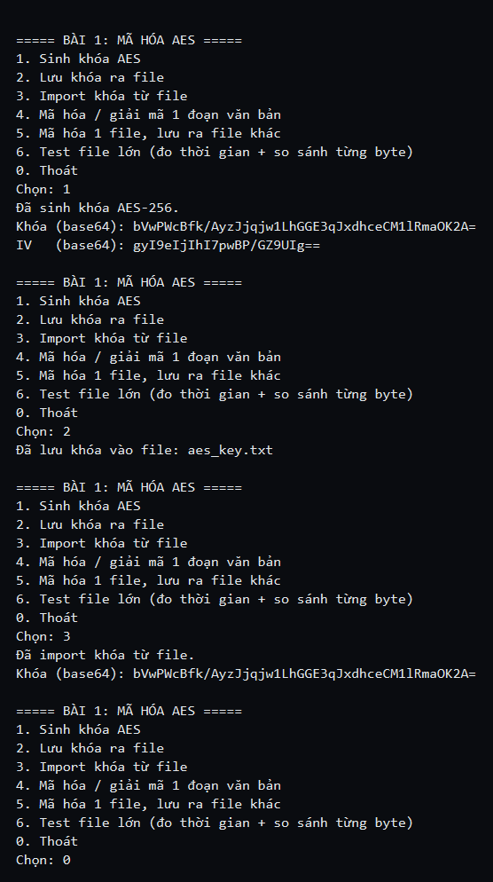

# Bài 1 — Mã hóa AES (đối xứng)

Ứng dụng console, mã hóa và giải mã dùng **cùng một khóa**.
Viết bằng C# / .NET 10, dùng thư viện `System.Security.Cryptography`.

## Chức năng

| STT | Chức năng |
|---|---|
| 1 | Sinh khóa AES-256 (kèm IV ngẫu nhiên) |
| 2 | Lưu khóa ra file `aes_key.txt` (dạng base64, 2 dòng: khóa + IV) |
| 3 | Import khóa từ file |
| 4 | Mã hóa / giải mã 1 đoạn văn bản, in kết quả ra màn hình |
| 5 | Mã hóa 1 file, lưu ra file khác (và giải mã lại) |
| 6 | Test file lớn: tạo file → mã hóa → giải mã → so sánh từng byte |

Thuật toán: **AES-256-CBC**, đệm PKCS#7, IV ngẫu nhiên 16 byte.
File lớn được xử lý bằng `CryptoStream` (đọc/ghi từng khối 1 MB) nên không cần nạp cả file vào RAM.

## Cách chạy

```bash
cd Bai1_AES
dotnet run
```

## Kết quả thực nghiệm (file 1 GB)

Máy test: file nguồn 1024 MB (1 GB).

| Thao tác | Kích thước | Thời gian | Tốc độ |
|---|---|---|---|
| Tạo file test | 1024 MB | 1373 ms | — |
| Mã hóa AES-256 | 1024 MB | 4594 ms | ~222.9 MB/s |
| Giải mã AES-256 | 1024 MB | 6341 ms | ~161.5 MB/s |
| So sánh từng byte | 1024 MB | 2747 ms | — |

Kết quả so sánh: file gốc và file giải mã **giống hệt 100%** (từng byte).

Ví dụ mã hóa văn bản:

```
Nhap doan van ban: Xin chao the gioi
Ban ma (base64): x1U+J4564YT1iBwp0wxlfU6qmzElcw7xlnM3r6XA2W4=
Giai ma lai     : Xin chao the gioi
```

## Kết luận

- File sau khi giải mã giống file gốc 100%, AES không làm sai lệch dữ liệu.
- Mã hóa và giải mã đều rất nhanh (trên 150 MB/s) nhờ CPU có hỗ trợ AES-NI.
- Vì vậy AES rất phù hợp để mã hóa dữ liệu lớn (file, ổ đĩa…), khác hẳn RSA (rất chậm, chỉ dùng cho dữ liệu nhỏ).

## Ảnh minh chứng




