# An toàn và Bảo mật Thông tin

| Thông tin | Nội dung |
|---|---|
| **Môn học** | An toàn và Bảo mật Thông tin |
| **Lớp** | 59KMT |
| **Giảng viên hướng dẫn** | Đỗ Duy Cốp |
| **Sinh viên thực hiện** | Trần Văn Khải |
| **MSSV** | K235480106035 |

Repo gồm 2 phần bài tập:

- **Phần 1 — Python**: DES/AES, RSA, các mô hình áp dụng RSA, so sánh RSA–AES và mã hóa lai ghép.
- **Phần 2 — .NET**: đề mới (xem [`de-bai-moi.md`](de-bai-moi.md)) gồm Bài 1 mã hóa AES và Bài 2 mã hóa RSA.

---

## Phần 1 — Python

### Nội dung
- Cài đặt **AES-128** thuần Python (ECB + CBC), kiểm thử bằng vector chuẩn FIPS-197.
- **RSA**: sinh cặp khóa (Miller–Rabin, Euclid mở rộng).
- Ba mô hình áp dụng RSA: xác thực người gửi, xác thực người nhận, cả hai.
- So sánh tốc độ mã hóa/giải mã RSA và AES.
- Mã hóa lai ghép RSA + AES (hybrid).

### Cấu trúc
```text
bt01_des-aes/              # mô tả DES/AES + cài đặt AES-128
bt02_rsa-keygen/           # nguyên lý sinh khóa RSA
bt03_rsa-models-hybrid/    # 3 mô hình RSA + hybrid + benchmark
evidence/                  # log chạy thực tế
images/                    # ảnh minh chứng + sơ đồ
run-all.sh                 # chạy toàn bộ
```

### Cách chạy
```bash
python3 --version
pip3 install pycryptodome
bash run-all.sh
```

### Kết quả

| Nội dung | Kết quả |
|---|---|
| AES-128 vector FIPS-197 | `69c4e0d8...70b4c55a` → **PASS** |
| AES-CBC mã/giải mã | round-trip **OK** |
| RSA-2048 sinh khóa + mã/giải mã | **OK** |
| 3 mô hình RSA | **HỢP LỆ**; sửa nội dung bị **từ chối** |
| Hybrid RSA + AES | khóa AES khôi phục **khớp**, giải mã **OK** |
| Tốc độ | AES ~**70 MB/s**; RSA-2048 ~**129 µs** mã / ~**22 ms** giải 1 khối |

Ảnh kết quả chạy:

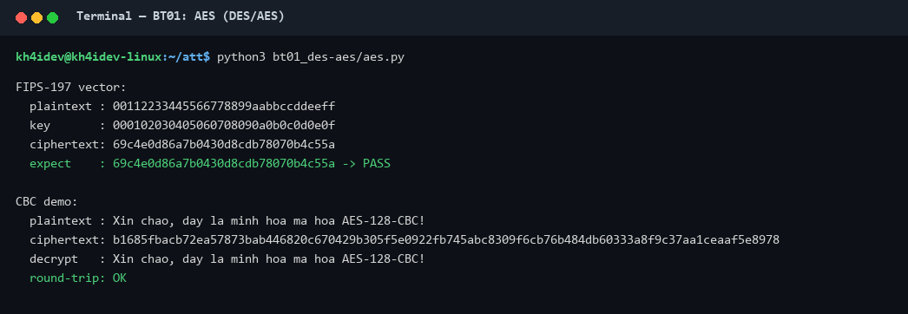

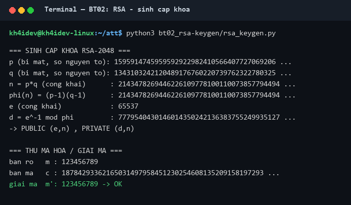

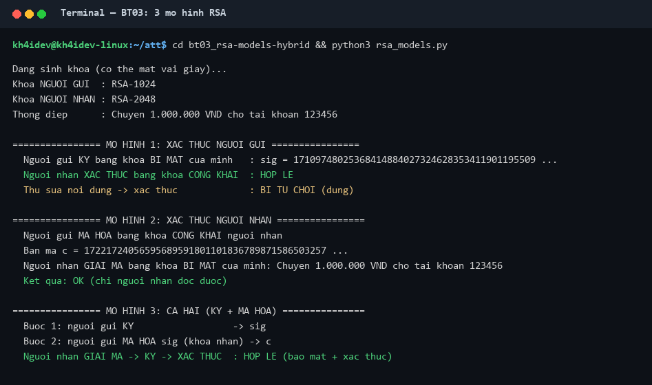

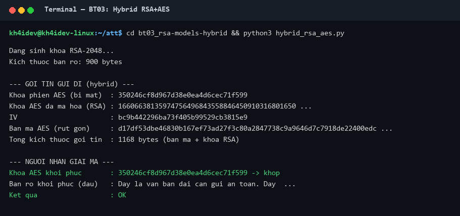

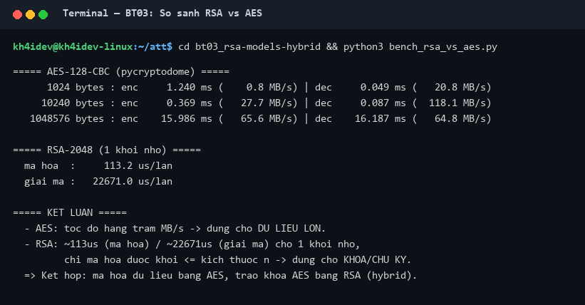

Sơ đồ minh họa:

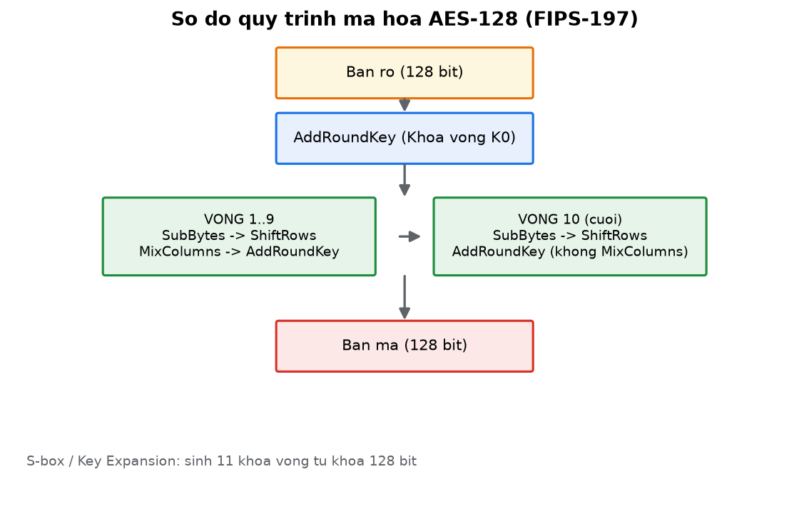

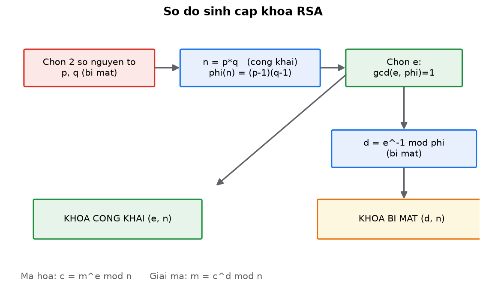

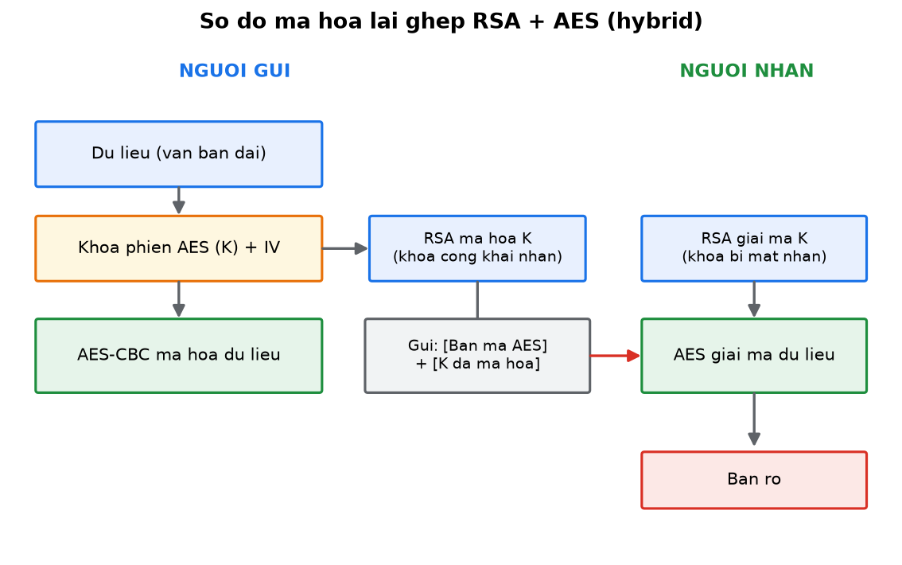

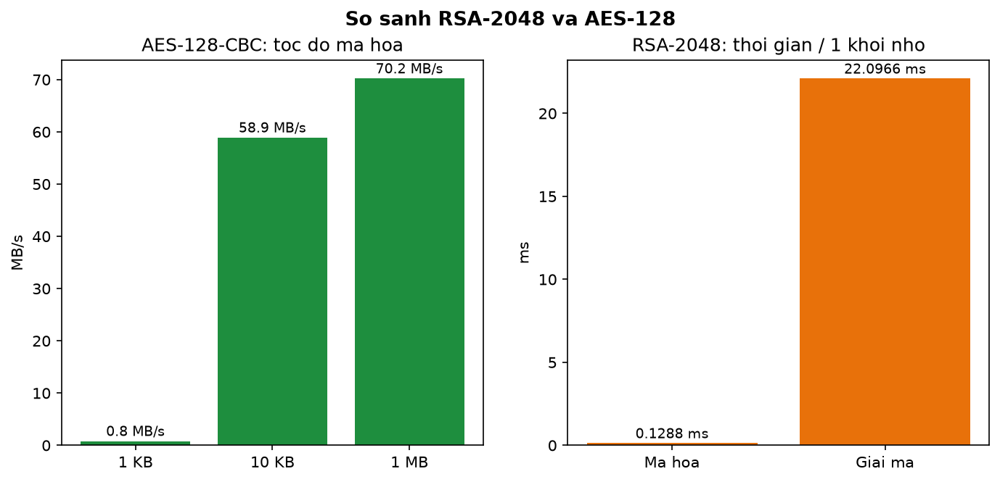

Log chạy đầy đủ: [`evidence/BAI1-2-3-KETQUA.md`](evidence/BAI1-2-3-KETQUA.md)

---

## Phần 2 — .NET

### Bài 1 — Mã hóa AES ([`Bai1_AES/`](Bai1_AES/))
Ứng dụng **console** (C#/.NET): sinh khóa AES-256, lưu/đọc khóa ra file, mã hóa–giải mã
văn bản, mã hóa file, và test file lớn hàng GB (đo thời gian + so sánh từng byte).

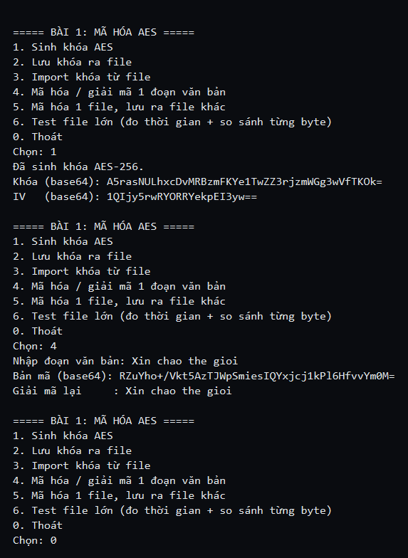

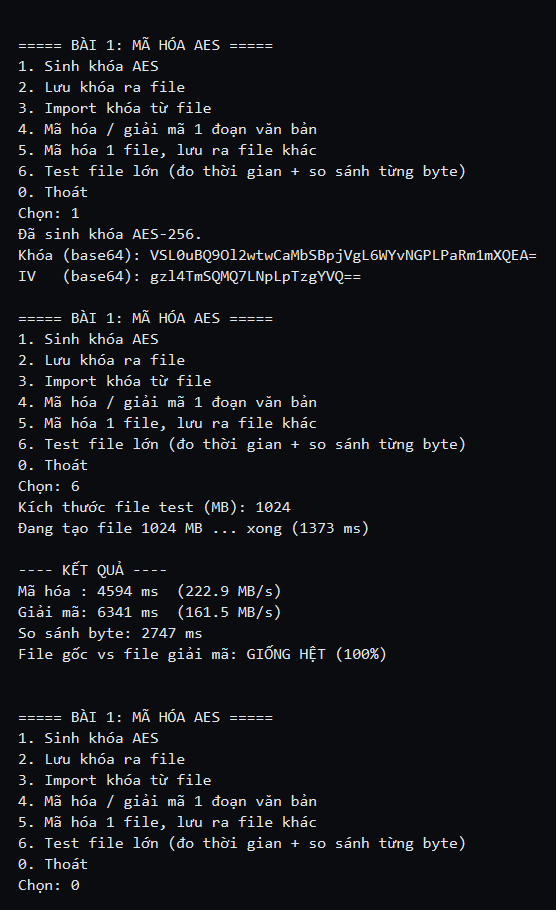

Chi tiết: [`Bai1_AES/README.md`](Bai1_AES/README.md)

### Bài 2 — Mã hóa RSA ([`Bai2_RSA/`](Bai2_RSA/))
Ứng dụng **Windows Forms**: sinh cặp khóa RSA, xuất/đọc PEM, mã hóa–giải mã dữ liệu nhỏ,
đo tốc độ public key vs private key, băm SHA-256, và chữ ký số (kèm đề xuất dùng
RSA-PSS để mỗi lần ký ra một chữ ký khác nhau).


Chi tiết: [`Bai2_RSA/README.md`](Bai2_RSA/README.md)

### Cách chạy
```bash
cd Bai1_AES && dotnet run
cd Bai2_RSA && dotnet run
```

---

## Nhận xét chung
- **AES** nhanh, phù hợp dữ liệu lớn; **RSA** chậm nhưng dùng để trao khóa / ký số.
- **Kết hợp**: mã hóa dữ liệu bằng **AES**, mã hóa khóa AES bằng **RSA** (giống TLS/HTTPS, PGP).

---
*Trần Văn Khải — MSSV: K235480106035*
